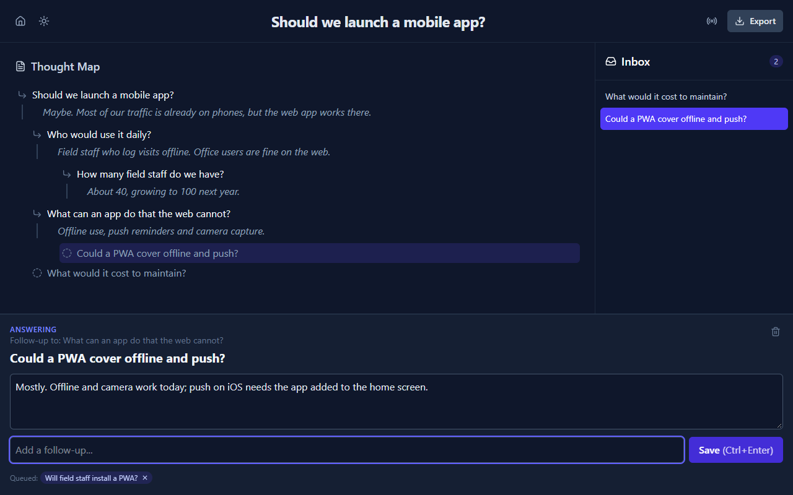

# Thought Map

**Question-driven brainstorming in the browser.** Start with a topic, answer it, and write down the follow-up questions your answer raises. Thought Map keeps those questions in an inbox and grows your answers into a mind-map style tree, so you can think a problem through one question at a time without losing any thread.



## Why

Most brainstorming and mind mapping tools give you a blank canvas. That is fine for collecting ideas, but it does not help you think them through. Thought Map takes the opposite approach: every node is a question, and you only move on by answering it. Each answer can spawn new questions, which wait in the inbox until you get to them. The result is a structured idea map of how you reasoned about a topic, not just a list of ideas.

It suits decision making, research planning, writing outlines, interview prep, or any problem where you want to ask "why?" and "what next?" until you reach the bottom.

## Features

- **Question-driven thinking.** Each map starts from a topic question. Answer it, queue follow-up questions, and save.
- **Inbox of open questions.** Unanswered questions wait in an inbox, oldest first. Move through it with the arrow keys.
- **Idea tree.** Answered questions form a hierarchical tree. Click any node to revise its answer or branch off new follow-ups.
- **Keyboard first.** Enter queues a follow-up, Tab switches fields, Ctrl/Cmd+Enter saves and jumps to the next question.
- **Local-first storage.** Maps are saved automatically in your browser (IndexedDB via [Yjs](https://github.com/yjs/yjs)). No account, no server, works offline once loaded.
- **Markdown export.** Download any map as a nested Markdown outline, with open questions listed at the end.
- **Multiple maps, light and dark themes.**
- **Experimental peer-to-peer (WebRTC).** A panel (radio icon in the header) opens a direct browser-to-browser data channel, either between tabs or between two machines by copy-pasting the connection offer and answer. It currently carries chat messages only; syncing maps between peers over this channel is the next step and is not built yet. See [docs/ARCHITECTURE.md](docs/ARCHITECTURE.md).

There is no AI or LLM in the app: the questions are yours.

## Quick start

Requires Node.js 20 or newer.

```bash
git clone https://github.com/goelanmol124/thought-map.git
cd thought-map
npm install
npm run dev
```

Open the URL Vite prints (usually http://localhost:5173), type a topic and press Enter.

| Command | What it does |
| --- | --- |
| `npm run dev` | Start the dev server |
| `npm run build` | Type-check and build to `dist/` |
| `npm run preview` | Serve the production build locally |
| `npm run lint` | ESLint |
| `npm test` | Unit tests (Vitest) for the state machines, map operations and Markdown export |
| `npm run test:e2e` | Playwright end-to-end tests (starts the dev server). Run `npx playwright install chromium` once, or set `PW_CHANNEL=chrome` to use an installed Chrome |

## How it works

- **Storage.** A single Yjs document holds all maps and settings and is persisted to IndexedDB with `y-indexeddb`. Older versions stored maps in `localStorage`; those are migrated on first load (`src/store/migration.ts`).
- **State.** UI state transitions are explicit, typed and unit-tested:
  - `src/state/mapOps.ts`: pure map operations (answer, delete subtree, rename) and the derived screen (`home` or `map`) and focus (`answering`, `revising`, `all-answered`, `nothing-selected`).
  - `src/state/answerDraft.ts`: a reducer for the answer panel draft (answer text, queued follow-ups, editing the question).
  - `src/webrtc/connectionMachine.ts`: the peer connection lifecycle (`idle`, `connecting`, `gathering`, `awaiting-peer`, `connected`, `disconnected`, `failed`).
- **Peer-to-peer.** `src/webrtc/` contains the transport layer: a `WebRTCPeer` wrapper around `RTCPeerConnection` with a data channel, and two signaling options, `BroadcastChannel` for tabs on the same machine and manual copy-paste for different machines. It uses public STUN servers and waits for ICE gathering to finish so each offer or answer is a single paste.

## Tech stack

React 19, TypeScript, Vite, Tailwind CSS v4, Yjs with y-indexeddb, WebRTC, lucide-react icons, Vitest and Playwright.

## Deploying

The build is a static site: deploy `dist/` to any static host (GitHub Pages, Netlify, Vercel, Cloudflare Pages, an S3 bucket). For GitHub Pages under a project path, build with `npx vite build --base=/thought-map/`.

Analytics are off by default. To enable Google Analytics for your own deployment, set `VITE_GA_MEASUREMENT_ID=G-XXXXXXXXXX` in `.env.local` or in your host's build environment; without it no tracking script is loaded.

## Status

A personal project, actively used as a thinking tool. Planned next: sync maps between peers over the WebRTC channel (a Yjs provider on top of the existing transport).
