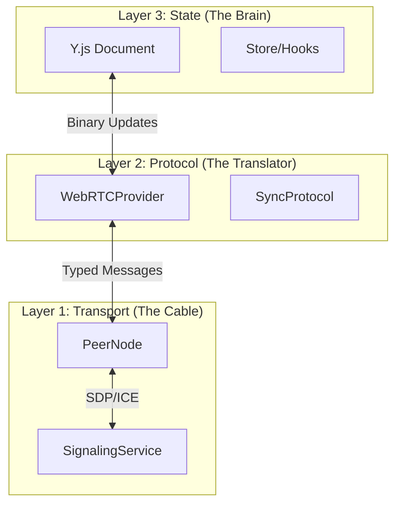
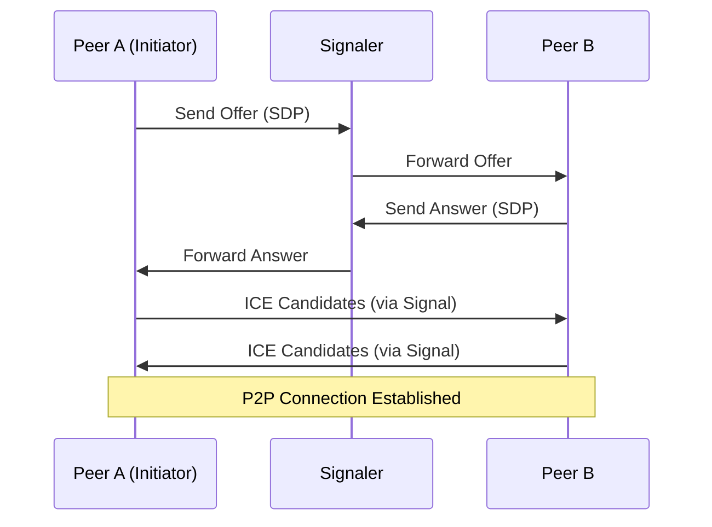
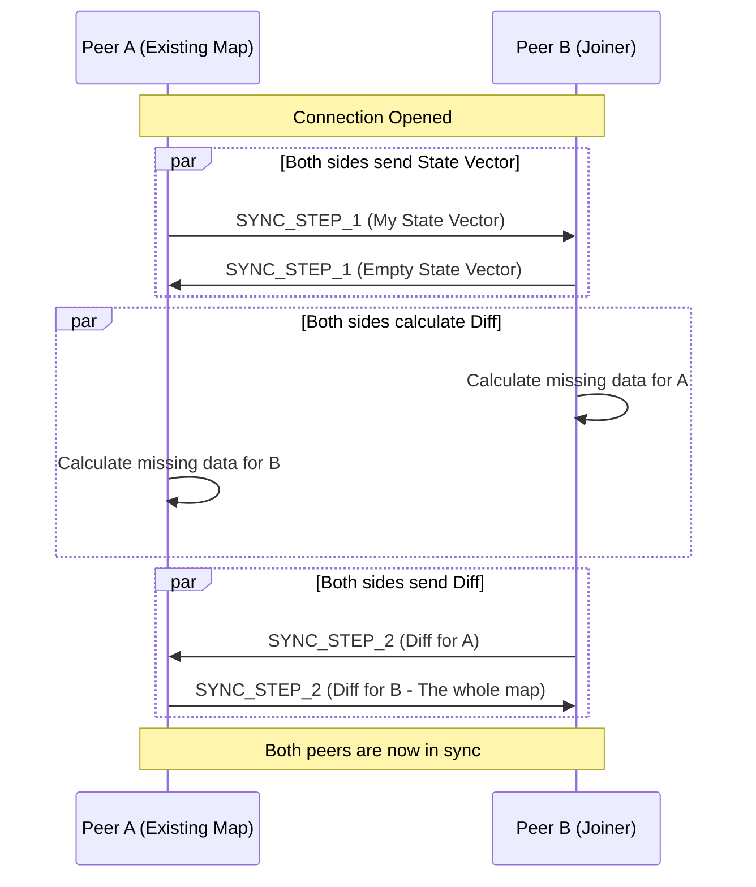

# WebRTC Architecture & Protocol Standards

This document defines the architectural standards, component interfaces, and wire protocols for the Thought Map WebRTC integration. All contributors must adhere to these specifications to ensure modularity and independent testing.

## 1. System Architecture

The system is divided into three strictly decoupled layers.



### Layer Responsibilities

*   **Transport Layer (`PeerNode`)**: Responsible ONLY for moving bytes from Point A to Point B. It knows nothing about Y.js, Maps, or Syncing. It handles `RTCPeerConnection`, ICE Candidates, and Data Channels.
*   **Protocol Layer (`WebRTCProvider`)**: Responsible for the *meaning* of the messages. It defines the handshake (Sync Step 1/2) and wraps Y.js updates into a standard message format.
*   **State Layer (`Y.js`)**: The source of truth. It emits binary updates and accepts binary updates.

---

## 2. Component Interfaces

### 2.1 Transport Layer: `PeerNode`

The `PeerNode` class abstracts the complexity of WebRTC.

```typescript
interface PeerNode {
    // Unique ID of this peer
    readonly id: string;

    // Connect to a remote peer
    connect(targetPeerId: string): Promise<void>;

    // Send data (string or binary)
    send(data: Message): void;

    // Close connection
    disconnect(): void;

    // Event Listeners
    on(event: 'connect', listener: () => void): void;
    on(event: 'disconnect', listener: () => void): void;
    on(event: 'data', listener: (data: Message) => void): void;
    on(event: 'error', listener: (error: Error) => void): void;
}
```

### 2.2 Transport Layer: `SignalingService`

The signaling service exchanges connection metadata (SDP/ICE) before the direct link is established.

```typescript
interface SignalingService {
    // Send a signal to a specific peer
    sendSignal(targetId: string, data: any): void;

    // Receive signals intended for this peer
    onSignal(callback: (senderId: string, data: any) => void): void;
}
```

### 2.3 Protocol Layer: `SyncProtocol`

Defines the message structure.

```typescript
type MessageType = 'HANDSHAKE' | 'SYNC_STEP_1' | 'SYNC_STEP_2' | 'UPDATE';

interface Message {
    type: MessageType;
    payload: any; // Usually Uint8Array (Base64 encoded if JSON transport)
}
```

---

## 3. Wire Protocol

All messages sent over the WebRTC Data Channel MUST adhere to this JSON structure.
*Note: While Y.js updates are binary, we will wrap them in a lightweight JSON envelope for easier debugging and type safety in Phase 1. We can optimize to pure binary later.*

### 3.1 Message Types

| Type | Payload | Description |
| :--- | :--- | :--- |
| `SYNC_STEP_1` | `string` (Base64) | **State Vector**. Sent by Peer A to Peer B to say "Here is what I have". |
| `SYNC_STEP_2` | `string` (Base64) | **Diff**. Sent by Peer B back to Peer A containing the missing data. |
| `UPDATE` | `string` (Base64) | **Incremental Update**. Sent whenever a user makes a change. |

### 3.2 Example Payload

```json
{
  "type": "UPDATE",
  "payload": "AQIDBAUGBwgJCgsMDQ4PEA==" // Base64 encoded Uint8Array
}
```

---

## 4. Interaction Flows

### 4.1 Connection Establishment



### 4.2 Initial Sync (The Handshake)

When the connection opens, peers must sync their state.



---

## 5. Design Standards & Best Practices

1.  **Error Handling**:
    *   **Transport**: If `PeerNode` encounters a connection error, it must emit an `error` event and attempt to close cleanly. It should NOT automatically retry (leave that policy to the UI/App layer).
    *   **Protocol**: If a malformed message is received, log a warning and IGNORE it. Do not crash the app.

2.  **Concurrency**:
    *   Y.js handles conflict resolution automatically.
    *   **Rule**: ALWAYS apply updates received from the network immediately. Do not buffer them unless absolutely necessary.

3.  **Testing**:
    *   **Unit Tests**: `Protocol` parsing must be unit tested.
    *   **Integration Tests**: `PeerNode` should be tested with a mock Signaler.

4.  **Code Style**:
    *   Use `async/await` for all asynchronous operations.
    *   Strict typing for all interfaces. No `any` in the Protocol layer.
